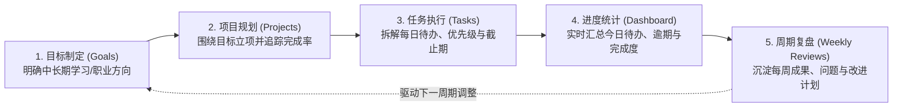

# 01 - 产品需求文档 (PRD)：StudyFlow · 学程

> **项目名称**：StudyFlow（学程）—— 大学生学习与项目管理平台  
> **文档版本**：v1.0（第一阶段冻结版）  
> **制定日期**：2026-10-30  
> **项目定位**：面向大学生的“目标制定 → 项目规划 → 任务执行 → 进度统计 → 周期复盘”全链路个人学习与工程实践管理 Web 应用  
> **比赛关联背景**：第四届全国大学生职业规划大赛（成长赛道）核心工程实践项目——支撑“从算法竞赛积累走向软件工程实践”的职业发展主线

---

## 1. 项目背景与问题定义

### 1.1 痛点分析
大学生（尤其是计算机与软件工程相关专业学生）在日常学习与职业准备过程中，往往同时推进**课程学习、程序设计竞赛训练（如蓝桥杯、码蹄杯、天梯赛）、个人开发项目、新技术自学**等多条主线。在实际执行中普遍存在以下四个核心痛点：

1. **任务分散，缺乏统一视图**：日常待办散落在备忘录、社交软件收藏夹、纸质便签或不同刷题网站中，缺少统一的任务汇聚与今日执行视图。
2. **有长期目标，但难以拆解落地**：立下“备战算法省赛”“三个月转型软件工程开发”等长期目标后，缺乏“目标 → 具象项目 → 每日可执行任务”的结构化拆解机制，容易半途而废。
3. **个人项目缺乏工程化进度追踪**：在从单题算法练习转向完整软件项目开发时，缺少里程碑与任务完成率量化反馈，难以直观评估项目推进状态。
4. **只做不复盘，成长轨迹不可见**：完成阶段性学习或开发后缺乏结构化的每周复盘（成果、遇到的问题、下周改进计划），在总结个人能力成长或准备职业规划复盘时缺乏真实过程证据。

### 1.2 产品核心理念
**StudyFlow（学程）** 的目标**不是**开发另一个简单的 To-Do 待办清单，而是围绕大学生的长期成长目标，建立一套完整的闭环工作流：

> **核心价值主张**：不只记录“今天要做什么”，更让学生清晰看见“自己每一天的任务执行，正在如何推进个人项目与长期职业目标的达成”。

---

## 2. 目标用户与典型使用场景

### 2.1 目标用户画像
- **核心用户**：有明确专业进阶诉求、竞赛备赛计划或个人项目开发需求的在校大学生（首版聚焦**个人单用户工作空间**，保障各账号数据严格隔离）。
- **典型代表场景**：已具备一定程序设计竞赛基础（如蓝桥杯、码蹄杯、天梯赛获奖经历），正在向**软件开发工程师**目标迈进，需要系统化管理工程技术学习、个人项目迭代与每周成长复盘的学生开发者。

### 2.2 四大核心使用场景

| 场景编号 | 用户场景 | 核心痛点与需求 | StudyFlow 解决方案 |
| :--- | :--- | :--- | :--- |
| **SC-01** | **备战程序设计竞赛**（如蓝桥杯 / 码蹄杯 / 天梯赛） | 需要在赛前 1~2 个月内系统复习动态规划、图论、数据结构并完成真题模拟，容易漏专题或拖延 | 创建学习目标“冲刺程序设计省赛”，建立专题训练项目，按天排布计划日期（`planned_date`）与截止日期（`due_date`），逾期自动高亮提醒 |
| **SC-02** | **开发个人软件工程项目**（如 StudyFlow / 余额查询工具工程化升级） | 从写单文件算法题转向多模块工程开发，容易迷失在繁杂的前后端细节中，不清楚整体进度 | 创建项目并关联至“软件开发工程师能力进阶”目标，将需求分析、数据库设计、接口联调、验收测试拆解为子任务，系统自动按已完成任务数计算项目实时进度百分比 |
| **SC-03** | **日常课程与新技术学习**（如 React / TypeScript / 数据库安全） | 零散的技术文档阅读与课程大作业穿插，优先级混乱 | 支持不绑定特定项目的**独立任务**创建，通过高/中/低优先级（`priority`）与状态流转（`todo` → `doing` → `done`）聚焦每日核心产出 |
| **SC-04** | **每周成长总结与改进复盘** | 周末回顾时记不清本周到底完成了哪些任务，遇到的问题没有记录，下周继续踩坑 | 在“每周复盘”模块结合当周任务完成统计，按自然周（`week_start`）结构化记录“本周成果、遇到的问题、下周改进计划”，同一自然周支持更新覆盖，沉淀连续的成长时间线 |

---

## 3. 核心业务实体与闭环逻辑

系统围绕四个核心业务数据实体构建，全部归属于当前登录用户（`user_id`）：

1. **学习目标 (`Goals`)**：顶层方向指引（如“掌握现代 Web 全栈开发并交付 MVP 项目”），包含目标名称、详细说明、目标达成日期与当前状态（进行中 `active` / 已完成 `completed` / 已暂停 `paused`）。
2. **项目 (`Projects`)**：支撑目标落地的具体载体（如“StudyFlow 平台首版研发”）。可关联至某个学习目标（`goal_id` 可空，支持独立项目），具备独立的截止日期、状态及自动计算的**项目完成率**。
3. **任务 (`Tasks`)**：最小执行单元。可归属于某个项目（`project_id` 可空，支持日常独立任务），包含标题、状态（`todo` / `doing` / `done`）、优先级（`low` / `medium` / `high`）、计划执行日期（`planned_date`）、截止日期（`due_date`）及实际完成时间戳（`completed_at`）。
4. **周复盘 (`Weekly Reviews`)**：周期性反思记录。以自然周起始日（周一 `week_start`）为唯一周期标识，记录本周成果（`achievements`）、遇到的问题（`problems`）与下周计划（`next_plan`）。

---

## 4. 产品范围边界（In-Scope vs. Out-of-Scope）

为了确保在约 2 周的开发周期内高质量交付可运行、可验证、可演示的工程级 MVP，第一阶段严格冻结需求边界：

### 4.1 首版必做范围（In-Scope）
- 基于邮箱账号密码的注册、登录、退出与路由鉴权保护；
- 多用户数据严格隔离（PostgreSQL Row Level Security 策略 + 本地双模式隔离支持）；
- 学习目标（Goals）的增删改查与状态切换；
- 项目（Projects）的增删改查、目标关联、详情页子任务视图与实时完成率计算；
- 删除项目时**保留原有任务并自动解除项目关联**（防止误删学习记录）；
- 任务（Tasks）的增删改查、多维筛选（状态/优先级/所属项目/视图）、今日计划与逾期提醒；
- 学习总览（Dashboard）真实数据聚合展示（今日任务、逾期任务、进行中项目进度、完成统计）；
- 每周复盘（Weekly Reviews）按自然周唯一保存（Upsert 防重）与历史复盘时间线查阅；
- 桌面端优先的左侧导航布局 + `390px` 移动端窄屏自适应支持。

### 4.2 首版暂缓范围（Out-of-Scope，列入 V2 演进规划）
- 暂不开发 AI 自动拆解任务或 AI 聊天助手（避免喧宾夺主，聚焦核心工程闭环）；
- 暂不开发多人团队协作、班级群组管理或复杂 RBAC 角色权限；
- 暂不开发复杂的拖拽式看板（Kanban Drag-and-Drop）与富文本编辑器，首版采用高可用、清晰的列表与结构化表单交互；
- 暂不开发第三方日历同步、积分排行榜与原生移动端 App。
