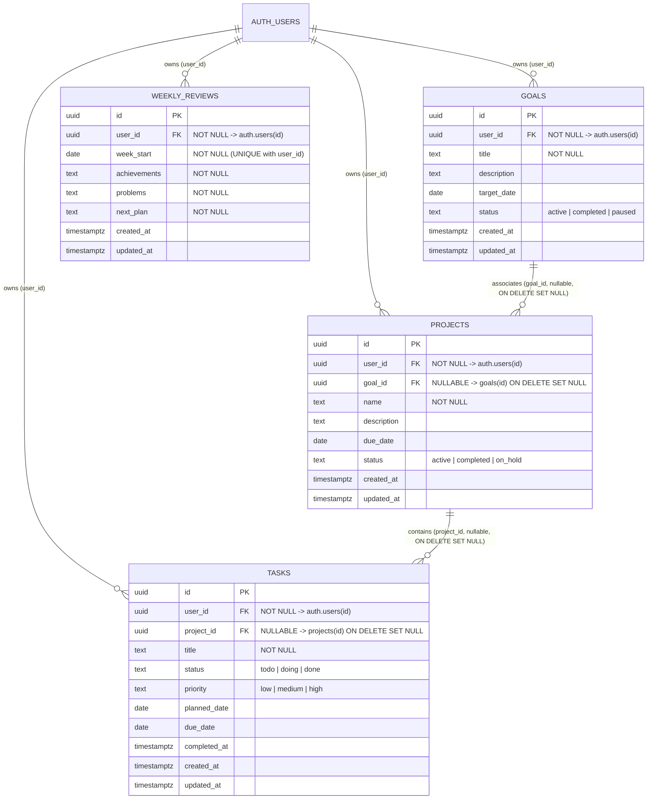

# 04 - 数据库设计与数据安全规范 (Database & RLS Design)

> **项目名称**：StudyFlow（学程）—— 大学生学习与项目管理平台  
> **文档版本**：v1.0（第一阶段冻结版）  
> **制定日期**：2026-10-30  
> **数据库引擎**：PostgreSQL 15+（Supabase 托管） + 本地持久化隔离适配器（双模式无缝切换）

---

## 1. 实体关系图 (ER Diagram)



---

## 2. 核心数据库表结构约定

### 2.1 `public.goals`（学习目标表）
| 字段名 | 类型 | 必填 | 默认值 | 约束与说明 |
| :--- | :--- | :---: | :--- | :--- |
| `id` | `uuid` | 是 | `gen_random_uuid()` | 主键 |
| `user_id` | `uuid` | 是 | `auth.uid()` | 外键关联 `auth.users(id) ON DELETE CASCADE` |
| `title` | `text` | 是 | - | 目标名称（非空校验 `char_length(trim(title)) > 0`） |
| `description` | `text` | 否 | `''` | 目标补充说明 |
| `target_date` | `date` | 否 | `NULL` | 目标期望达成日期 |
| `status` | `text` | 是 | `'active'` | 枚举检查：`CHECK (status IN ('active', 'completed', 'paused'))` |
| `created_at` | `timestamptz` | 是 | `now()` | 创建时间 |
| `updated_at` | `timestamptz` | 是 | `now()` | 最后更新时间（触发器自动维护） |

### 2.2 `public.projects`（项目表）
| 字段名 | 类型 | 必填 | 默认值 | 约束与说明 |
| :--- | :--- | :---: | :--- | :--- |
| `id` | `uuid` | 是 | `gen_random_uuid()` | 主键 |
| `user_id` | `uuid` | 是 | `auth.uid()` | 外键关联 `auth.users(id) ON DELETE CASCADE` |
| `goal_id` | `uuid` | 否 | `NULL` | 外键关联 `public.goals(id) ON DELETE SET NULL`（允许独立项目） |
| `name` | `text` | 是 | - | 项目名称（非空校验 `char_length(trim(name)) > 0`） |
| `description` | `text` | 否 | `''` | 项目说明 |
| `due_date` | `date` | 否 | `NULL` | 项目截止日期 |
| `status` | `text` | 是 | `'active'` | 枚举检查：`CHECK (status IN ('active', 'completed', 'on_hold'))` |
| `created_at` | `timestamptz` | 是 | `now()` | 创建时间 |
| `updated_at` | `timestamptz` | 是 | `now()` | 最后更新时间 |

### 2.3 `public.tasks`（任务表）
| 字段名 | 类型 | 必填 | 默认值 | 约束与说明 |
| :--- | :--- | :---: | :--- | :--- |
| `id` | `uuid` | 是 | `gen_random_uuid()` | 主键 |
| `user_id` | `uuid` | 是 | `auth.uid()` | 外键关联 `auth.users(id) ON DELETE CASCADE` |
| `project_id` | `uuid` | 否 | `NULL` | **外键关联 `public.projects(id) ON DELETE SET NULL`**（删除项目时保留任务并解绑） |
| `title` | `text` | 是 | - | 任务标题（非空校验 `char_length(trim(title)) > 0`） |
| `status` | `text` | 是 | `'todo'` | 枚举检查：`CHECK (status IN ('todo', 'doing', 'done'))` |
| `priority` | `text` | 是 | `'medium'` | 枚举检查：`CHECK (priority IN ('low', 'medium', 'high'))` |
| `planned_date` | `date` | 否 | `NULL` | 计划执行日期 |
| `due_date` | `date` | 否 | `NULL` | 截止日期 |
| `completed_at` | `timestamptz` | 否 | `NULL` | 完成时间（`status = 'done'` 时写入，否则为 `NULL`） |
| `created_at` | `timestamptz` | 是 | `now()` | 创建时间 |
| `updated_at` | `timestamptz` | 是 | `now()` | 最后更新时间 |

### 2.4 `public.weekly_reviews`（每周复盘表）
| 字段名 | 类型 | 必填 | 默认值 | 约束与说明 |
| :--- | :--- | :---: | :--- | :--- |
| `id` | `uuid` | 是 | `gen_random_uuid()` | 主键 |
| `user_id` | `uuid` | 是 | `auth.uid()` | 外键关联 `auth.users(id) ON DELETE CASCADE` |
| `week_start` | `date` | 是 | - | 自然周起始日期（周一），**联合唯一约束 `UNIQUE (user_id, week_start)`** |
| `achievements` | `text` | 是 | `''` | 本周成果 |
| `problems` | `text` | 是 | `''` | 遇到的问题与不足 |
| `next_plan` | `text` | 是 | `''` | 下周改进计划 |
| `created_at` | `timestamptz` | 是 | `now()` | 创建时间 |
| `updated_at` | `timestamptz` | 是 | `now()` | 最后更新时间 |

---

## 3. 数据安全与 Row Level Security (RLS) 设计（对应 `AC-10`）

### 3.1 安全设计原则
1. **默认拒绝未授权访问**：4 张业务表全部强制开启 `ENABLE ROW LEVEL SECURITY`，撤销 `anon`（匿名未登录角色）的任何写权限，仅授予 `authenticated` 角色最小必需的表级权限。
2. **基于 `auth.uid()` 的行级隔离**：任何用户执行 `SELECT`、`INSERT`、`UPDATE`、`DELETE` 时，必须满足 `user_id = auth.uid()`。
3. **跨用户外键关联防御（关键安全要求）**：
   - 防止用户 A 在创建/修改项目（`projects`）时，将 `goal_id` 指向用户 B 的 `goals.id`；
   - 防止用户 A 在创建/修改任务（`tasks`）时，将 `project_id` 指向用户 B 的 `projects.id`；
   - 在 `projects` 和 `tasks` 的 `INSERT / UPDATE` RLS `WITH CHECK` 子句中，显式通过 `EXISTS` 子查询校验所关联的目标/项目同样归属于 `auth.uid()`。

### 3.2 完整 SQL 迁移与 RLS 脚本草案
该脚本将在第二阶段落地为 `supabase/migrations/001_init_studyflow.sql`：

```sql
-- 1. 启用 UUID 扩展与通用 updated_at 触发器函数
create extension if not exists "pgcrypto";

create or replace function public.set_updated_at()
returns trigger
language plpgsql
as $$
begin
  new.updated_at = now();
  return new;
end;
$$;

-- 2. 创建 goals 表
create table if not exists public.goals (
  id uuid primary key default gen_random_uuid(),
  user_id uuid not null default auth.uid() references auth.users(id) on delete cascade,
  title text not null check (char_length(trim(title)) > 0),
  description text not null default '',
  target_date date,
  status text not null default 'active' check (status in ('active', 'completed', 'paused')),
  created_at timestamptz not null default now(),
  updated_at timestamptz not null default now()
);

-- 3. 创建 projects 表
create table if not exists public.projects (
  id uuid primary key default gen_random_uuid(),
  user_id uuid not null default auth.uid() references auth.users(id) on delete cascade,
  goal_id uuid references public.goals(id) on delete set null,
  name text not null check (char_length(trim(name)) > 0),
  description text not null default '',
  due_date date,
  status text not null default 'active' check (status in ('active', 'completed', 'on_hold')),
  created_at timestamptz not null default now(),
  updated_at timestamptz not null default now()
);

-- 4. 创建 tasks 表（删除项目时保留任务并解绑 project_id）
create table if not exists public.tasks (
  id uuid primary key default gen_random_uuid(),
  user_id uuid not null default auth.uid() references auth.users(id) on delete cascade,
  project_id uuid references public.projects(id) on delete set null,
  title text not null check (char_length(trim(title)) > 0),
  status text not null default 'todo' check (status in ('todo', 'doing', 'done')),
  priority text not null default 'medium' check (priority in ('low', 'medium', 'high')),
  planned_date date,
  due_date date,
  completed_at timestamptz,
  created_at timestamptz not null default now(),
  updated_at timestamptz not null default now()
);

-- 5. 创建 weekly_reviews 表（每位用户每个自然周唯一）
create table if not exists public.weekly_reviews (
  id uuid primary key default gen_random_uuid(),
  user_id uuid not null default auth.uid() references auth.users(id) on delete cascade,
  week_start date not null,
  achievements text not null default '',
  problems text not null default '',
  next_plan text not null default '',
  created_at timestamptz not null default now(),
  updated_at timestamptz not null default now(),
  constraint weekly_reviews_user_week_unique unique (user_id, week_start)
);

-- 6. 索引优化
create index if not exists idx_goals_user_id on public.goals(user_id);
create index if not exists idx_projects_user_id on public.projects(user_id);
create index if not exists idx_projects_goal_id on public.projects(goal_id);
create index if not exists idx_tasks_user_id on public.tasks(user_id);
create index if not exists idx_tasks_project_id on public.tasks(project_id);
create index if not exists idx_tasks_dates on public.tasks(user_id, status, planned_date, due_date);
create index if not exists idx_weekly_reviews_user_week on public.weekly_reviews(user_id, week_start desc);

-- 7. 绑定 updated_at 自动更新触发器
create trigger trg_goals_updated_at before update on public.goals
  for each row execute function public.set_updated_at();

create trigger trg_projects_updated_at before update on public.projects
  for each row execute function public.set_updated_at();

create trigger trg_tasks_updated_at before update on public.tasks
  for each row execute function public.set_updated_at();

create trigger trg_weekly_reviews_updated_at before update on public.weekly_reviews
  for each row execute function public.set_updated_at();

-- 8. 启用 RLS 与表级权限控制
alter table public.goals enable row level security;
alter table public.projects enable row level security;
alter table public.tasks enable row level security;
alter table public.weekly_reviews enable row level security;

revoke all on public.goals, public.projects, public.tasks, public.weekly_reviews from anon;
grant select, insert, update, delete on public.goals, public.projects, public.tasks, public.weekly_reviews to authenticated;

-- 9. goals RLS 策略
create policy "goals_select_own" on public.goals
  for select to authenticated using (user_id = auth.uid());
create policy "goals_insert_own" on public.goals
  for insert to authenticated with check (user_id = auth.uid());
create policy "goals_update_own" on public.goals
  for update to authenticated using (user_id = auth.uid()) with check (user_id = auth.uid());
create policy "goals_delete_own" on public.goals
  for delete to authenticated using (user_id = auth.uid());

-- 10. projects RLS 策略（含跨用户 goal_id 绑定拦截）
create policy "projects_select_own" on public.projects
  for select to authenticated using (user_id = auth.uid());
create policy "projects_insert_own" on public.projects
  for insert to authenticated
  with check (
    user_id = auth.uid()
    and (
      goal_id is null
      or exists (select 1 from public.goals g where g.id = goal_id and g.user_id = auth.uid())
    )
  );
create policy "projects_update_own" on public.projects
  for update to authenticated
  using (user_id = auth.uid())
  with check (
    user_id = auth.uid()
    and (
      goal_id is null
      or exists (select 1 from public.goals g where g.id = goal_id and g.user_id = auth.uid())
    )
  );
create policy "projects_delete_own" on public.projects
  for delete to authenticated using (user_id = auth.uid());

-- 11. tasks RLS 策略（含跨用户 project_id 绑定拦截）
create policy "tasks_select_own" on public.tasks
  for select to authenticated using (user_id = auth.uid());
create policy "tasks_insert_own" on public.tasks
  for insert to authenticated
  with check (
    user_id = auth.uid()
    and (
      project_id is null
      or exists (select 1 from public.projects p where p.id = project_id and p.user_id = auth.uid())
    )
  );
create policy "tasks_update_own" on public.tasks
  for update to authenticated
  using (user_id = auth.uid())
  with check (
    user_id = auth.uid()
    and (
      project_id is null
      or exists (select 1 from public.projects p where p.id = project_id and p.user_id = auth.uid())
    )
  );
create policy "tasks_delete_own" on public.tasks
  for delete to authenticated using (user_id = auth.uid());

-- 12. weekly_reviews RLS 策略
create policy "weekly_reviews_select_own" on public.weekly_reviews
  for select to authenticated using (user_id = auth.uid());
create policy "weekly_reviews_insert_own" on public.weekly_reviews
  for insert to authenticated with check (user_id = auth.uid());
create policy "weekly_reviews_update_own" on public.weekly_reviews
  for update to authenticated using (user_id = auth.uid()) with check (user_id = auth.uid());
create policy "weekly_reviews_delete_own" on public.weekly_reviews
  for delete to authenticated using (user_id = auth.uid());
```

---

## 4. 双模式数据访问层架构 (Supabase + Local Persistence)

为了兼顾**生产级云端数据库架构要求**与**比赛答辩/本地免配置演示稳定性**，前端数据访问层（Repository Layer）采用统一接口设计：

1. **Supabase 云端引擎 (`SupabaseDataRepository`)**：
   - 当检测到环境变量 `VITE_SUPABASE_URL` 与 `VITE_SUPABASE_ANON_KEY` 时激活；
   - 使用 `@supabase/supabase-js` 直接与 PostgreSQL + Auth + RLS 交互；
   - 周复盘采用 `.upsert({ user_id, week_start, ... }, { onConflict: 'user_id,week_start' })`。
2. **本地持久化引擎 (`LocalDataRepository`)**：
   - 当未配置云端密钥或开启演示模式时自动激活，数据持久化在浏览器 `localStorage` 中；
   - **完整复刻 PostgreSQL 的全部约束逻辑**：
     - 严格按 `currentSession.user.id` 过滤所有读写请求；
     - 写入 `projects.goal_id` 或 `tasks.project_id` 时，强制校验目标/项目的 `user_id` 与当前用户一致（否则抛出 `RLS Policy Violation: 禁止关联其他用户的资源` 错误）；
     - 删除 `projects` 时，自动遍历将该项目的任务 `project_id` 设为 `null` 并保留任务记录；
     - 保存 `weekly_reviews` 时，严格按 `(user_id, week_start)` 唯一键执行 Upsert 覆盖更新。
3. **内置真实背景种子数据 (`Seed Data`)**：
   - 预设主演示账号内置贴合开发者真实经历的成长数据：
     - 目标 1：**“从程序设计竞赛向软件开发工程师转型”**（关联项目：`StudyFlow 大学生学习与项目管理平台 MVP`，内含 5 个开发任务且已完成 3 个，精确演示 `60%` 完成率；关联项目：`WhaleBalance 余额查询工具工程化重构`）；
     - 目标 2：**“算法竞赛省赛冲刺与复盘沉淀”**（结合码蹄杯省赛银奖、蓝桥杯省三、天梯赛团队奖经历，设置动态规划与图论复盘任务）；
     - 包含今日待办任务、1 条逾期未完成任务（用于直观验证逾期高亮提醒 `AC-05`）以及 2 周真实的周复盘记录。
